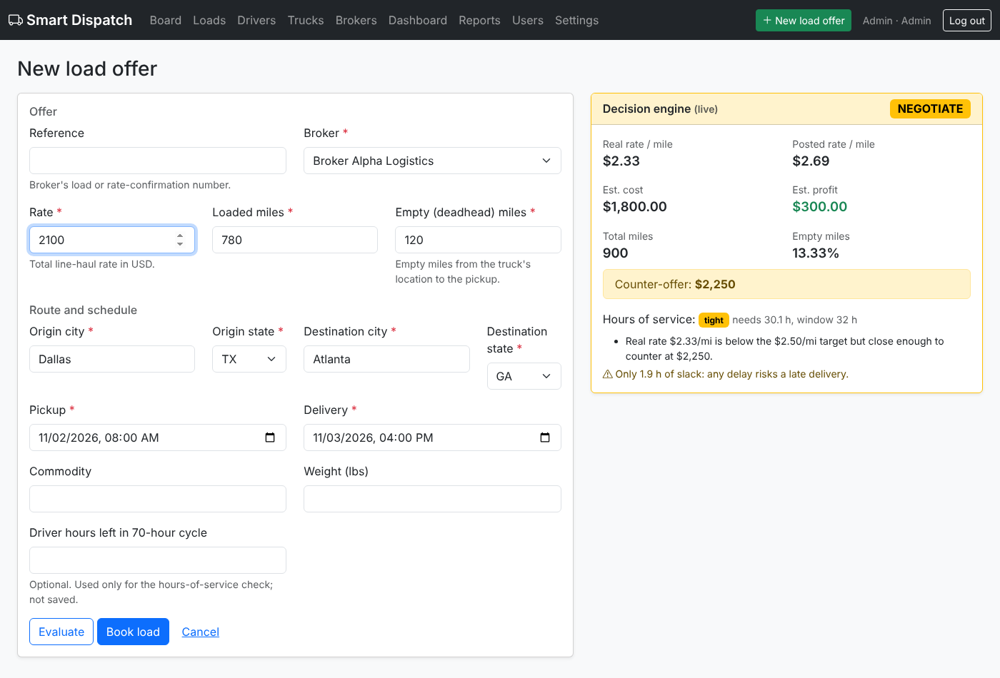

# Smart Dispatch

Web-based smart dispatch platform for small US carriers (1–5 trucks) and remote
dispatch teams. BIS Project, WIUT, student 00013457.

It manages loads, drivers, trucks and brokers, helps the dispatcher decide which
loads to take with a **load decision and profitability engine**, and gives
managers an **analytics dashboard** of lanes, brokers, empty miles and weekly profit.



## Run it

```bash
cd smart-dispatch
python3 -m venv .venv
source .venv/bin/activate          # Windows: .venv\Scripts\activate
pip install -r requirements.txt
python manage.py migrate
python manage.py seed_demo --reset # anonymised demo data
python manage.py runserver
```

Open http://127.0.0.1:8000 and log in as `dispatcher`, `manager` or `admin`
(password `demo12345`). Run the tests with `python manage.py test tests`.

## How it maps to the PID

| PID requirement | Where |
|---|---|
| Registration, secure login, Dispatcher / Manager / Admin roles | `accounts/` |
| Add, edit, delete, list loads, drivers, trucks (and brokers) | `dispatch/views.py`, `templates/dispatch/` |
| Assign a load to a driver and a truck | `dispatch/services.py` → `assign_load` |
| Status board (Available, Dispatched, In transit, Delivered) | `/board/` |
| Decision engine: real rate per mile incl. empty miles, cost and profit vs cost-per-mile benchmark, hours-of-service check, Accept / Negotiate / Reject | `engine/core.py` |
| Editable cost-per-mile benchmark | `/settings/` (admin) → `engine/models.py` |
| Analytics dashboard: best lanes, best brokers, empty-mile %, weekly gross and profit | `/dashboard/`, `analytics/metrics.py` |
| Reports: loads by status, loads per driver, total miles for a selected week | `/reports/` |
| REST API layer | `POST /api/evaluate/` (used by the live engine panel) |
| Telegram bot: driver status updates and POD collection | `telegram_bot/` |
| Black-box testing | `tests/` (41 tests) |
| Anonymised test data | `python manage.py seed_demo` |

## Telegram bot for drivers

Drivers use Telegram instead of logging in to the web app. They can:

- get a message with the load details when the dispatcher assigns them a load,
- send `/load` to see their current load,
- tap **Picked up – in transit** and **Delivered** to update its status (same rules as the web app),
- send a **photo or PDF of the signed POD**, which appears on the load page under "Proof of delivery".
  PODs sent up to 72 hours after delivery attach to that delivered load.

### Set it up

1. In Telegram, open **@BotFather**, send `/newbot`, and follow the steps. Copy the **token** and the bot's **username**.
2. Set them as environment variables, in the same terminal where you run the commands.

   Windows (Command Prompt):
   ```bat
   set TELEGRAM_BOT_TOKEN=123456:ABC-your-token
   set TELEGRAM_BOT_USERNAME=your_bot_username
   ```
   macOS / Linux: `export TELEGRAM_BOT_TOKEN=...` and `export TELEGRAM_BOT_USERNAME=...`
3. Run the web app and the bot in **two terminals** (set the variables in both):
   ```bash
   python manage.py runserver
   python manage.py run_telegram_bot
   ```
4. In the web app go to **Drivers → Not linked → Create link code**. Open the `t.me/...` link on the
   driver's phone (or send `/start CODE` to the bot). The driver is now linked.
5. Dispatch a load to that driver: the bot sends them the load.

Never commit the bot token to GitHub. If it leaks, revoke it with @BotFather (`/revoke`).

The bot uses long polling, so it works on a laptop without a public URL. It talks to the
Telegram Bot API with Python's standard library, so it needs no extra packages.

## Architecture

Layered, as in the PID:

- **Presentation**: Django templates, Bootstrap 5, Chart.js (`templates/`)
- **Application / API**: Django views and a JSON endpoint (`*/views.py`, `config/urls.py`)
- **Driver channel**: Telegram bot (`telegram_bot/`), which reuses the same business-logic layer
- **Business logic**: `engine/core.py` (pure Python, no Django imports, so it is unit-tested on its own) and `dispatch/services.py` (assignment and status rules)
- **Data**: relational models (`*/models.py`), SQLite in development; switch to PostgreSQL in `config/settings.py`

Entities: User, Broker, Driver, Truck, Load, Assignment, ProofOfDelivery, CompanySettings.
Broker "average rate per mile" and "number of loads" are calculated from loads
rather than stored, so they can't fall out of date.

## Decision engine rules

With the default settings (cost $2.00/mi, target profit $0.50/mi, 15% band):

1. **Real rate per mile** = rate ÷ (loaded miles + empty miles).
2. **Estimated profit** = rate − total miles × cost per mile.
3. **Hours of service** (simplified FMCSA property-carrying rules): at most 11 h driving per shift,
   a 30-min break after 8 h of driving, 10 h off between shifts, plus loading/unloading time.
   Compared with the pickup-to-delivery window, and optionally with the driver's hours left in the 70-hour cycle.
   The 14-hour window, sleeper-berth splits and the 34-hour restart are not modelled.
4. **Recommendation**:
   - not legally feasible → **Reject**
   - real rate ≥ cost + target profit → **Accept**
   - within 15% of the target rate → **Negotiate**, with a counter-offer rounded up to $25
   - otherwise → **Reject**
5. Warnings for below break-even, empty miles over 20%, and tight schedules (< 2 h slack).

All benchmarks are editable by an admin. They are estimates, not live market rates (see PID limitations).
