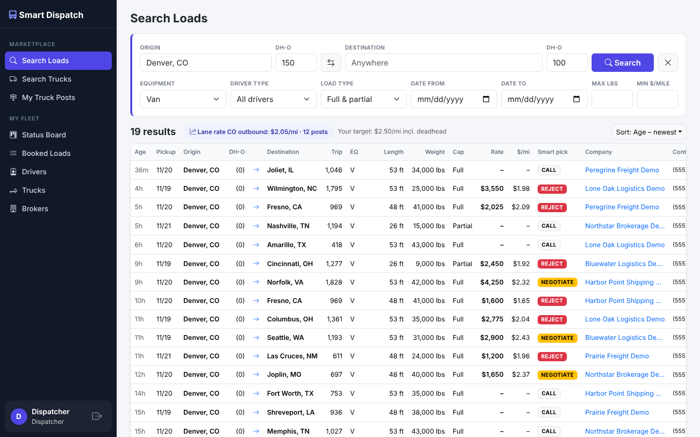
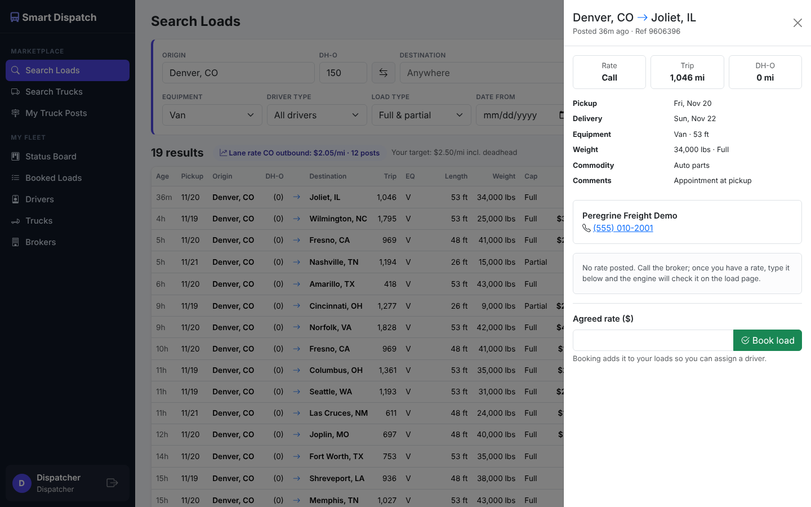
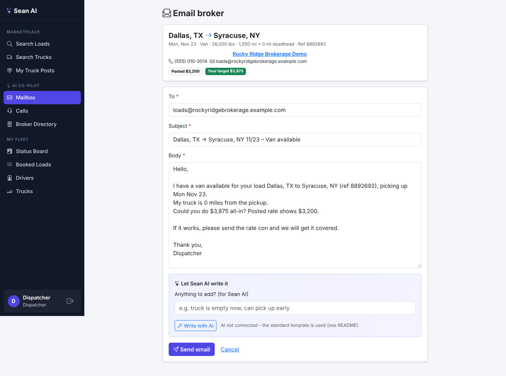
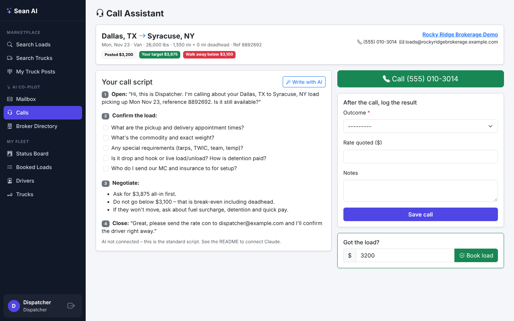
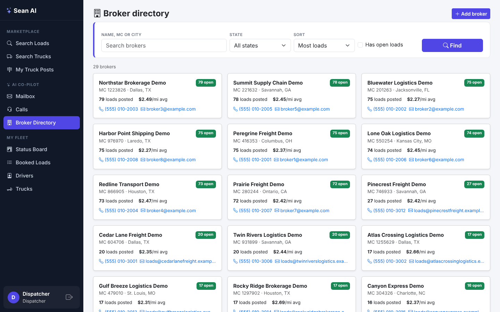

# Sean AI

Web-based smart dispatch platform for small US carriers (1–5 trucks) and remote
dispatch teams. BIS Project, WIUT, student 00013457.

Sean AI combines the best parts of three tools dispatchers use:

| Inspired by | What Sean AI does |
|---|---|
| **DAT One** | Search loads and trucks with DH-O / DH-D radius, equipment, dates and rate filters |
| **Neblo AI** | Email brokers from any load, or many at once; AI writes the email; Mailbox of everything sent |
| **Numeo AI** | Broker directory (contacts, lanes, rates) and an AI **Call Assistant** for calling brokers |

It works like a load board (DAT One, Neblo): dispatchers **search loads** by origin,
deadhead, destination, equipment and dates, and brokers **search trucks**. Every load
in the results is scored by the **decision engine** (Accept / Negotiate / Reject using
real rate per mile including deadhead), so the dispatcher sees at a glance which loads pay.
A booked load goes into the carrier's TMS (assign driver and truck, status board,
Telegram bot for drivers), and managers get an **analytics dashboard**.



## How to run it on Windows (step by step)

You need **Python 3.10 or newer** from [python.org](https://www.python.org/downloads/).
When installing, tick **"Add Python to PATH"**.

### Step 1: Open Command Prompt

Press the **Windows key**, type **cmd**, and press Enter. You will see something like
`C:\Users\YourName>`. Type every command below here.

> If you see `>>>`, you are inside Python, not Command Prompt. Type `exit()` and press Enter first.
> Commands like `python --version` and `pip install` do not work at the `>>>` prompt.

Check Python works:

```bat
python --version
```

If `python` is not found, try `py --version` and use `py` wherever these steps say `python`.

### Step 2: Get the project

**With Git:**

```bat
git clone -b claude/cool-goldberg-czu1lr https://github.com/Sherzodbek1717/WIUT.git
cd WIUT\smart-dispatch
```

**Without Git** (if you get *'git' is not recognized*):

1. Download the [project zip](https://github.com/Sherzodbek1717/WIUT/archive/refs/heads/claude/cool-goldberg-czu1lr.zip).
2. Right-click the zip, choose **Extract All**.
3. In Command Prompt, type `cd ` (with a space), drag the **smart-dispatch** folder into the window, and press Enter.

### Step 3: Install and start

Run these one at a time and wait for each to finish:

```bat
python -m venv .venv
.venv\Scripts\activate
pip install -r requirements.txt
python manage.py migrate
python manage.py seed_demo --reset
python manage.py runserver
```

After `activate`, the prompt starts with `(.venv)`. That means it worked.

### Step 4: Open the app

When you see `Starting development server at http://127.0.0.1:8000/`, open
**http://127.0.0.1:8000** in your browser and log in:

| Username | Password | What they see |
|---|---|---|
| `dispatcher` | `demo12345` | Search Loads, Search Trucks, My Truck Posts, the fleet pages |
| `broker` | `demo12345` | Search Trucks, My Load Posts (post loads) |
| `manager` | `demo12345` | Dashboard and reports |
| `admin` | `demo12345` | Everything, plus users and settings |

The demo loads are dated from the day you seed them. On another day, refresh them with:

```bat
python manage.py seed_marketplace
```

Keep the Command Prompt window open while you use the app. Closing it (or pressing **Ctrl+C**) stops the server.

### Next time

You only install once. To start the app again:

```bat
cd WIUT\smart-dispatch
.venv\Scripts\activate
python manage.py runserver
```

After pulling new code, also run `pip install -r requirements.txt` and `python manage.py migrate`.

### macOS / Linux

Same steps, but use `python3 -m venv .venv` and `source .venv/bin/activate`.

### Run the tests

```bat
python manage.py test tests
```

## Project documents (for the report)

| Document | Contents |
|---|---|
| [docs/design.md](docs/design.md) | Process (as-is / to-be), use cases, architecture, booking sequence, ERD, design decisions |
| [docs/traceability.md](docs/traceability.md) | Every PID objective, scope item and FR → status, code, test; limitations for the evaluation |
| [docs/testing.md](docs/testing.md) | Black-box test plan: 41 test cases incl. boundary values, plus manual checks |
| [docs/test-results.md](docs/test-results.md) | Results of the last real run of all automated tests (`python scripts/test_report.py`) |
| [docs/api.md](docs/api.md) | JSON API with real example responses |
| [docs/survey.md](docs/survey.md) | Survey questionnaire (40+ responses) and interview guide |
| [docs/deployment.md](docs/deployment.md) | Putting the site online (PythonAnywhere) |
| `docs/diagrams/*.png` | Diagrams ready to paste into Word |

## Load board

**Search Loads** (dispatchers)

- Origin and **DH-O** radius, optional destination and **DH-D** radius (“Anywhere” if empty), swap button
- Equipment, solo/team, full/partial, pickup dates, max weight, minimum $/mile
- Results like DAT: age, pickup, origin, DH-O, destination, trip miles, equipment, length, weight, rate, $/mile, company, contact
- **Smart pick** column: the decision engine's Accept / Negotiate / Reject (or *Call* when no rate is posted)
- **Lane rate**: average posted $/mile for the lane over the last 30 days
- Sort by age, rate, rate per mile, DH-O, trip length or pickup date
- Click a row for details, broker contact and the full engine breakdown, then **Book load** with the agreed rate
- Recent searches on the empty page, like Neblo

**Search Trucks** (brokers and dispatchers): available trucks near a pickup, with the carrier's contact.

**My Truck Posts** (dispatchers) and **My Load Posts** (brokers) put trucks and loads on the marketplace.



Distances (DH-O, DH-D, trip miles) are estimated from city coordinates: straight-line miles × 1.17,
a typical road-to-straight-line ratio. A routing API would give exact road miles. The city list covers
about 150 US freight markets (`loadboard/geo.py`).

The load board is the platform's own marketplace. Pulling loads from DAT or Truckstop needs
their paid partner APIs, which the PID puts out of scope.

## AI Co-Pilot

**Email brokers (like Neblo).** In a load's details press **Email broker**: the email is pre-written with
the lane, pickup, your truck's distance and your target rate, plus your signature with MC number
(set it in **My profile**, bottom-left). **Write with AI** lets Sean AI rewrite it, optionally with a note
("can pick up early"). To email many brokers at once, tick loads in the results and press
**Email selected brokers**: one template, personalised per load. Every email is saved in **Mailbox**.



**Call Assistant (like Numeo).** Shows your **target rate** and **walk-away rate** (break-even including deadhead,
from the engine settings), a call script with questions and negotiation tips (AI-written on request),
a one-tap **Call** button, a form to log the result, and **Book load** with the agreed rate. All calls are in **Calls**.



**Broker directory (like Numeo).** Every broker that posts on the platform, plus any you add yourself, with MC
number, city, contacts, how many loads they post, their average $/mile, their top lanes, their open loads
and your history with them. Search by name, MC or city; filter by state or "has open loads".



**What it does not do (yet).** Sean AI does not phone brokers by itself. A real AI voice agent needs a paid
telephony and voice service (for example Twilio plus a speech model) and must follow call-recording and
AI-disclosure rules, which is beyond this project; the Call Assistant prepares the dispatcher instead.
It also does not read brokers' websites (scraping is unreliable and often against their terms); the
directory is built from the platform's own postings and brokers you add.

### Connect the AI (optional)

Without a key the app works fully and uses built-in templates. To let Claude write emails and scripts,
create an API key at console.anthropic.com, then set it before `runserver` (it costs a little per use):

```bat
set ANTHROPIC_API_KEY=your-key-here
python manage.py runserver
```

Never put the key in code or on GitHub. The model is set by `SEAN_AI_MODEL` (default `claude-opus-5-5`).

### Really send emails (optional)

By default emails are printed in the server window (demo mode). To send through Gmail, create a
**Gmail app password** (Google Account → Security → 2-Step Verification → App passwords), then:

```bat
set EMAIL_BACKEND=django.core.mail.backends.smtp.EmailBackend
set EMAIL_HOST=smtp.gmail.com
set EMAIL_PORT=587
set EMAIL_USE_TLS=1
set EMAIL_HOST_USER=you@gmail.com
set EMAIL_HOST_PASSWORD=your-16-letter-app-password
python manage.py runserver
```

To rename the app, set `APP_NAME` (for example `set APP_NAME=Shawn AI`).

## How it maps to the PID

| PID requirement | Where |
|---|---|
| Registration, secure login, Dispatcher / Broker / Manager / Admin roles | `accounts/` |
| Load board: search loads and trucks, post loads and trucks, book a load | `loadboard/` |
| AI Co-Pilot: email brokers (single and bulk), call assistant, broker directory | `copilot/` |
| Add, edit, delete, list loads, drivers, trucks (and brokers) | `dispatch/views.py`, `templates/dispatch/` |
| Assign a load to a driver and a truck | `dispatch/services.py` → `assign_load` |
| Status board (Available, Dispatched, In transit, Delivered) | `/board/` |
| Decision engine: real rate per mile incl. empty miles, cost and profit vs cost-per-mile benchmark, hours-of-service check, Accept / Negotiate / Reject | `engine/core.py` |
| Editable cost-per-mile benchmark | `/settings/` (admin) → `engine/models.py` |
| Analytics dashboard: best lanes, best brokers, empty-mile %, weekly gross and profit | `/dashboard/`, `analytics/metrics.py` |
| Reports: loads by status, loads per driver, total miles for a selected week | `/reports/` |
| REST API layer | [docs/api.md](docs/api.md): `/api/evaluate/`, `/api/loadboard/search/`, `/api/loads/` |
| Telegram bot: driver status updates and POD collection | `telegram_bot/` |
| Black-box testing | `tests/` (87 tests), [docs/testing.md](docs/testing.md) |
| Anonymised test data | `python manage.py seed_demo` |

## Telegram bot for drivers

Drivers use Telegram instead of logging in to the web app. They can:

- get a message with the load details when the dispatcher assigns them a load,
- send `/load` to see their current load,
- tap **Picked up – in transit** and **Delivered** to update its status (same rules as the web app),
- send a **photo or PDF of the signed POD**, which appears on the load page under "Proof of delivery".
  PODs sent up to 72 hours after delivery attach to that delivered load.

### Set it up

1. In Telegram, open **@BotFather**, send `/newbot`, and follow the steps. Copy the **token** and the bot's **username**.
2. Set them as environment variables, in the same terminal where you run the commands.

   Windows (Command Prompt):
   ```bat
   set TELEGRAM_BOT_TOKEN=123456:ABC-your-token
   set TELEGRAM_BOT_USERNAME=your_bot_username
   ```
   macOS / Linux: `export TELEGRAM_BOT_TOKEN=...` and `export TELEGRAM_BOT_USERNAME=...`
3. Run the web app and the bot in **two terminals** (set the variables in both):
   ```bash
   python manage.py runserver
   python manage.py run_telegram_bot
   ```
4. In the web app go to **Drivers → Not linked → Create link code**. Open the `t.me/...` link on the
   driver's phone (or send `/start CODE` to the bot). The driver is now linked.
5. Dispatch a load to that driver: the bot sends them the load.

Never commit the bot token to GitHub. If it leaks, revoke it with @BotFather (`/revoke`).

The bot uses long polling, so it works on a laptop without a public URL. It talks to the
Telegram Bot API with Python's standard library, so it needs no extra packages.

## Architecture

Layered, as in the PID:

- **Presentation**: Django templates, Bootstrap 5, Chart.js (`templates/`)
- **Application / API**: Django views and a JSON endpoint (`*/views.py`, `config/urls.py`)
- **Driver channel**: Telegram bot (`telegram_bot/`), which reuses the same business-logic layer
- **AI layer**: `copilot/ai.py` calls Claude with structured JSON output and falls back to templates
- **Load board**: `loadboard/search.py` (radius search, lane rate, engine on each result) and `loadboard/geo.py` (cities and distances)
- **Business logic**: `engine/core.py` (pure Python, no Django imports, so it is unit-tested on its own) and `dispatch/services.py` (assignment and status rules)
- **Data**: relational models (`*/models.py`), SQLite in development; switch to PostgreSQL in `config/settings.py`

Entities: User, LoadPosting, TruckPosting, RecentSearch, EmailMessage, CallLog, Broker, Driver, Truck, Load, Assignment,
ProofOfDelivery, CompanySettings.
Broker "average rate per mile" and "number of loads" are calculated from loads
rather than stored, so they can't fall out of date.

## Decision engine rules

With the default settings (cost $2.00/mi, target profit $0.50/mi, 15% band):

1. **Real rate per mile** = rate ÷ (loaded miles + empty miles).
2. **Estimated profit** = rate − total miles × cost per mile.
3. **Hours of service** (simplified FMCSA property-carrying rules): at most 11 h driving per shift,
   a 30-min break after 8 h of driving, 10 h off between shifts, plus loading/unloading time.
   Compared with the pickup-to-delivery window, and optionally with the driver's hours left in the 70-hour cycle.
   The 14-hour window, sleeper-berth splits and the 34-hour restart are not modelled.
4. **Recommendation**:
   - not legally feasible → **Reject**
   - real rate ≥ cost + target profit → **Accept**
   - within 15% of the target rate → **Negotiate**, with a counter-offer rounded up to $25
   - otherwise → **Reject**
5. Warnings for below break-even, empty miles over 20%, and tight schedules (< 2 h slack).

All benchmarks are editable by an admin. They are estimates, not live market rates (see PID limitations).
