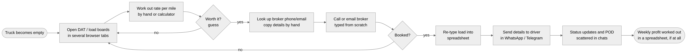
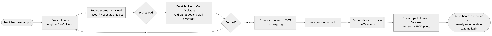
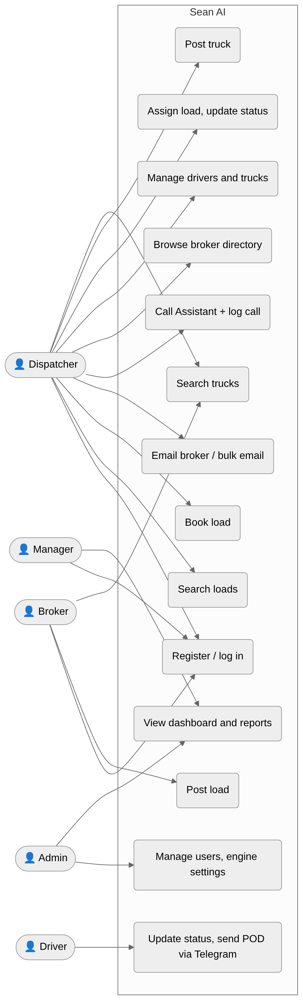
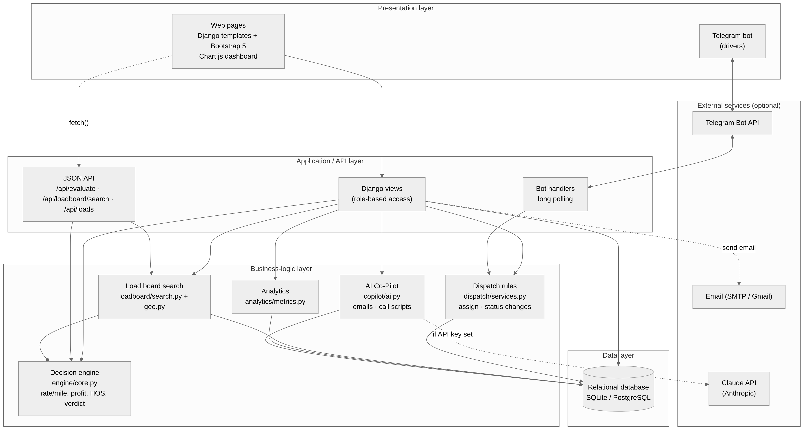
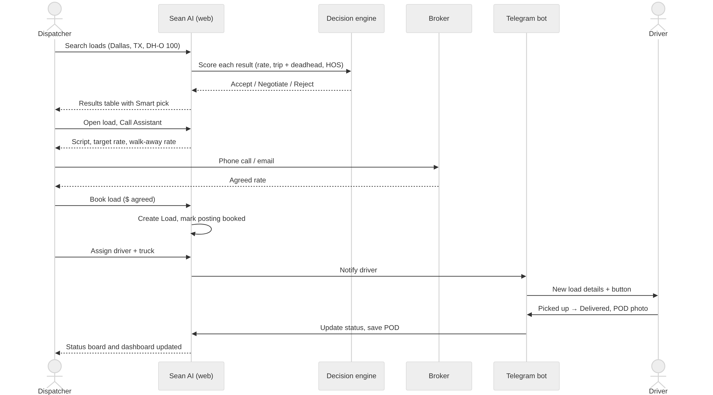
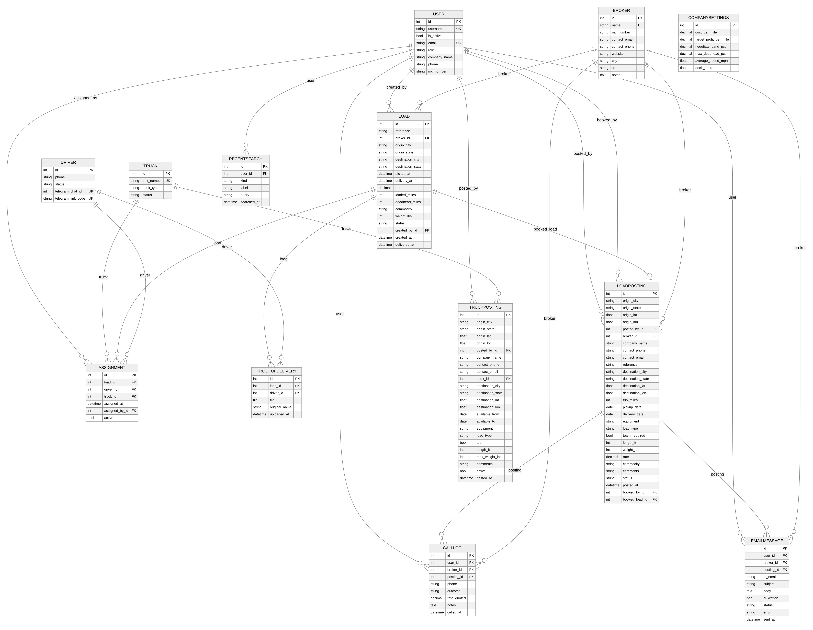

# System design

PID objective: *"To design the interface, database, and system architecture, producing interface
prototypes and an entity-relationship diagram."* Each diagram has a PNG (for the Word report) and
its Mermaid source (`docs/diagrams/*.mmd`, which GitHub renders and you can edit at mermaid.live).

## 1. Business process: as-is and to-be

**As-is** (small carriers today, from the PID rationale): many browser tabs, rates worked out by hand,
details re-typed into spreadsheets, driver updates scattered across chat apps.

**To-be** with Sean AI: one search scored by the decision engine, AI-assisted broker contact,
one-click booking into the TMS, Telegram updates from drivers, reports that update themselves.

## 2. Use cases

Five actors: dispatcher (main user), broker, manager, administrator and driver (Telegram only).

## 3. Architecture

The layered architecture from the PID. Business rules live in plain Python modules
(`engine/core.py` has no Django imports), so they can be tested on their own and reused by the web
pages, the JSON API and the Telegram bot.

| Decision | Choice | Reason |
|---|---|---|
| Framework | Django 5.2 (LTS) | Built-in authentication, admin, ORM, forms and CSRF protection; long-term support |
| Database | SQLite in development, PostgreSQL-ready | Zero setup for students and markers; one setting to switch |
| Front end | Server-rendered templates + Bootstrap 5, small JavaScript | Fast, works without a build step, responsive on phones |
| Business logic | Pure Python modules | Unit-testable; one source of truth for every channel |
| AI | Claude API, structured JSON output, fallback model, templates when no key | Reliable output format; the app never breaks without AI |
| Driver channel | Telegram bot (long polling) | Drivers already use Telegram; no app to install; works without a public URL |
| Distances | City coordinates × road factor 1.17 | Free and instant; a routing API would cost money |

## 4. Booking a load (sequence)

## 5. Database (entity-relationship diagram)

Generated from the actual Django models, so it always matches the code (Django's built-in
permission fields on User are left out for clarity).

Design notes:

- **Normalised to 3NF.** Brokers, drivers and trucks are stored once and referenced by foreign keys.
- **Assignment** links one load to one driver and one truck. A partial unique constraint allows only
  one *active* assignment per load, while keeping reassignment history.
- **Derived values are calculated, not stored**: a broker's average rate per mile, loads given,
  total miles and profit come from queries, so they cannot go out of date (PID entity "Broker" listed
  them as attributes).
- **LoadPosting** (marketplace) is separate from **Load** (the carrier's booked freight). Booking
  copies a posting into a Load and links them one-to-one.
- **CompanySettings** is a single-row table holding the editable cost-per-mile benchmark and other
  engine settings.
- **Database constraints** back up form validation: delivery after pickup, unique unit numbers,
  unique broker names, unique Telegram chats.

## 6. Interface

Screenshots of the implemented interface (replacing paper prototypes) are in `docs/screenshots/`:
Search Loads, load details, Search Trucks, Email broker, Call Assistant, Broker Directory, status
board, dashboard and the phone layout. Design principles: a dark sidebar like DAT One and Neblo, one
primary action per screen, colour used only for meaning (green Accept, amber Negotiate, red Reject),
large tap targets on phones, keyboard-accessible rows.

To regenerate the ERD after changing models: `python scripts/erd.py > docs/diagrams/erd.mmd`.
